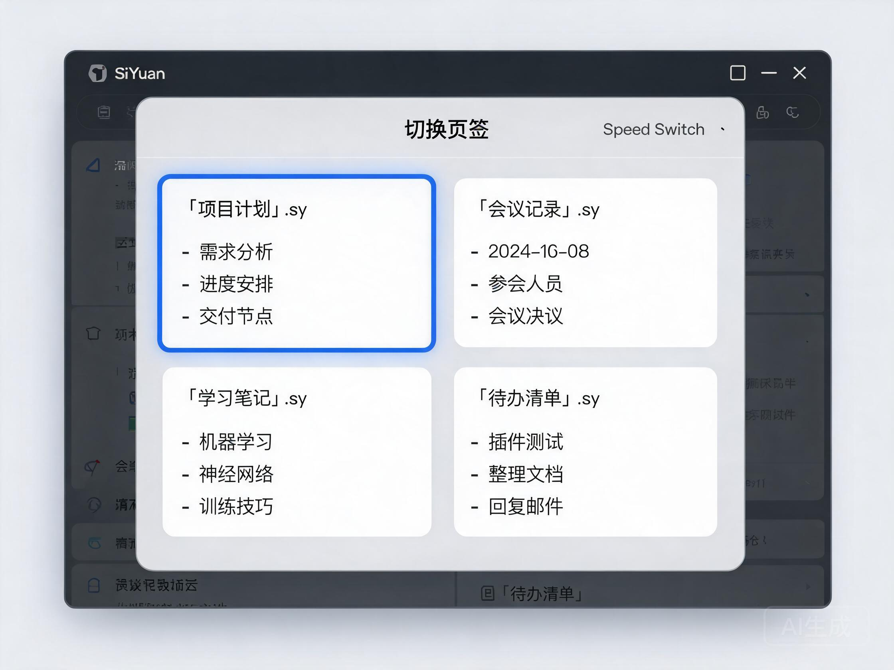
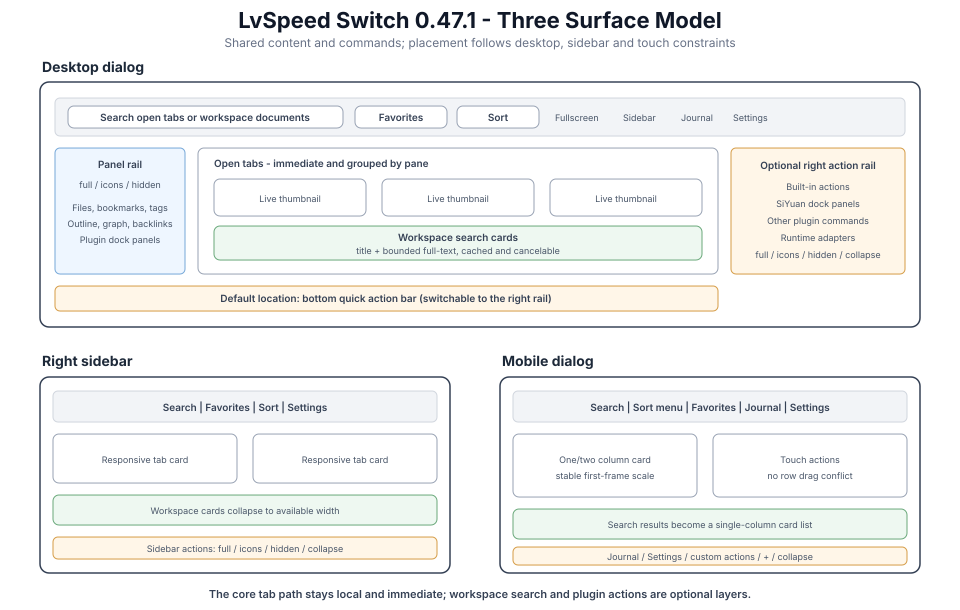
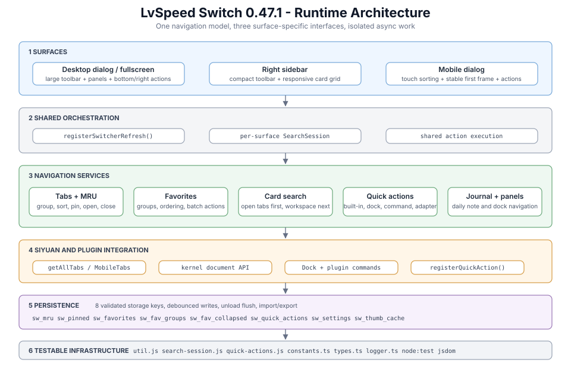

# LvSpeed Switch

[](./plugin.json) [](https://github.com/ai68298100/siyuan-speed-switch/actions/workflows/ci.yml) [](https://github.com/ai68298100/siyuan-speed-switch/releases/latest) [](./LICENSE) [](https://b3log.org/siyuan)

LvSpeed Switch is SiYuan Note's **unified switching and work-context platform**. One platform shell connects the switcher, workbench, snippet lab, and floating ball: find and preview content, inspect and arrange widgets, manage code snippets inside a safe boundary, and return to the last work surface from anywhere. Desktop, sidebar, and mobile share object, action, and status semantics while adapting their layouts to available space and input method.

> **Latest stable release: v0.48.7 (2026-10-23)**<br>
> [Download the GitHub Release](https://github.com/ai68298100/siyuan-speed-switch/releases/tag/v0.48.7) · [Release readiness](./docs/release-readiness.md) · [Roadmap](./ROADMAP.md)

## What's New In v0.48.7 (2026-10-23)

- **First Panel Masterpiece Polish (The Storefront Interface)**:
  - Tab cards (`.sw__card`) and document search results (`.sw__doc-item`) active indicator stripes upgraded to **interstellar purple to titanium raikiri gold dual-gradient energy shimmer** (`linear-gradient`) with ambient soft glow;
  - Window group counters (`.sw__group-count`) upgraded to branded rounded pill capsules with tabular numerals;
  - 1-9 direct access digit keycaps (`[data-sw-digit]::after`) upgraded with 2px physical mechanical keycap bottom edge and tactile inset shadow.
- **Ecosystem & Plugin Commands Discovery In Command Mode**: Switcher command mode (`>` or `》`) now discovers and filters all registered commands across installed plugins (including QuickGate, Checkin, Exam), enabling one-click and Enter execution.
- **Chinese Full-Width Punctuation Adaptive Routing**: Penetration search model natively supports Chinese full-width symbols (`！` $\to$ bookmark mode, `》` $\to$ command palette, `：` $\to$ outline penetration, `？` $\to$ cheatsheet).

Itemized changes, validation data, and release history are in the [complete changelog](./docs/CHANGELOG.en-US.md).

<details>
<summary>Older release updates (v0.47.0 and earlier)</summary>

The full itemized history is maintained in the [complete English changelog](./docs/CHANGELOG.en-US.md). This compact index keeps the README focused while preserving the release trail:

- v0.46.9: real-kernel E2E, bounded third-panel preview, mobile settings, and stale-state feedback.

</details>

<p align="center"></p>

<p align="center"></p>

## Xiaolv Plugins And Community

> **Beta notice**: 小驴考试, 小驴管家, 小驴闪卡, and 小驴常用 are beta plugins under active development and validation. Use QQ group **871707735** for bug reports, feature requests, and feedback.

All Xiaolv plugins are independently installable. LvSpeed Switch does not install or enable the others; plugins can cooperate through the documented [widget protocol](./docs/widget-protocol.md) and quick-action protocol.

| Plugin | One-line description | GitHub repository |
| --- | --- | --- |
| [小驴雷切](https://github.com/ai68298100/siyuan-speed-switch) | Local-first SiYuan navigation and work-context platform connecting tab switching, the widget workbench, snippet lab, and floating ball. | [siyuan-speed-switch](https://github.com/ai68298100/siyuan-speed-switch) |
| [小驴打卡](https://github.com/ai68298100/siyuan-checkin) | Local-first habits, check-ins, and review workspace. | [siyuan-checkin](https://github.com/ai68298100/siyuan-checkin) |
| [小驴人脉](https://github.com/ai68298100/siyuan-contacts) | Contact, relationship, organization, and interaction follow-up management in SiYuan. | [siyuan-contacts](https://github.com/ai68298100/siyuan-contacts) |
| [小驴拾遗](https://github.com/ai68298100/siyuan-glean) | A local reading library for confirmed, sorted, and reviewable SiYuan clippings. | [siyuan-glean](https://github.com/ai68298100/siyuan-glean) |
| [小驴考试（内测版）](https://github.com/ai68298100/siyuan-exam) | Local question banks, practice, mock exams, mistake review, and reviewable AI assistance. | [siyuan-exam](https://github.com/ai68298100/siyuan-exam) |
| [小驴管家（内测版）](https://github.com/ai68298100/siyuan-home) | Family and life ledgers, member records, due-date reminders, and follow-up management. | [siyuan-home](https://github.com/ai68298100/siyuan-home) |
| [小驴闪卡（内测版）](https://github.com/ai68298100/siyuan-lv-cards) | Local-first full-lifecycle flashcards and review built on SiYuan's native FSRS. | [siyuan-lv-cards](https://github.com/ai68298100/siyuan-lv-cards) |
| [小驴常用（内测版）](https://github.com/ai68298100/xiaolv-common) | Fast reuse of common phrases, templates, code, and other content from SiYuan documents and blocks. | [xiaolv-common](https://github.com/ai68298100/xiaolv-common) |

QQ community group: **871707735** (bug reports and feature requests)

## Table of Contents

- [Xiaolv Plugins And Community](#xiaolv-plugins-and-community)
- [Core Capabilities](#core-capabilities)
- [Work Context, Commands & Actions](#work-context-commands--actions-new)
- [Widget Panel: 58 Configurable Widgets](#widget-panel-58-configurable-widgets)
- [SiYuan Agent Capabilities](#siyuan-agent-capabilities)
- [Quick Start](#quick-start)
- [Shortcuts](#shortcuts)
- [Settings](#settings)
- [Install And Upgrade](#install-and-upgrade)
- [Troubleshooting & Support](#troubleshooting--support)
- [Privacy & Security](#privacy--security)
- [Requirements And Compatibility](#requirements-and-compatibility)
- [Architecture And Tests](#architecture-and-tests)
- [Development](#development)
- [Development Roadmap And Decision Records](#development-roadmap-and-decision-records)
- [Release Checklist](#release-checklist)
- [Changelog](#changelog)
- [License](#license)

## Four Entrances, One Work Path

| Entrance | What it helps you do | Availability |
| --- | --- | --- |
| **Switcher** (surface 1) | Search tabs, favorites, recents, full-library documents, and snippets; preview, open, locate, or execute | Desktop, sidebar, mobile; the right preview stays on wide desktop and degrades on narrow screens |
| **Workbench** (surface 2) | View, refresh, and arrange widgets, read health receipts, and restore the layout context | Desktop, sidebar, mobile |
| **Snippet Lab** (surface 3) | Manage native snippets, edit drafts, preview in isolation, and manually review AI output before saving | Desktop only; enter from the switcher surface navigation or a snippet object action; mobile shows the capability boundary |
| **Floating ball** (global trigger) | Open the platform, restore the last surface, run actions, and use 1–9 fixed slots from anywhere | Desktop main window and mobile; not mounted in the sidebar |

All four entrances share the platform header, context bar, status badges, action panel, and return semantics. The surfaces keep their distinct work modes: search and preview in the switcher, grid and layout in the workbench, editing and safety boundaries in the snippet lab, and fast touch-safe triggering in the floating ball.

The snippet lab needs desktop width for its editor, preview, and properties areas, so mobile does not present a pretend editing screen. The switcher's right preview covers the wide-desktop results area, the empty-query work context, and opened tabs; search results support `Alt` peek-open and `Ctrl+click / Ctrl+Enter` right-split open.

## Core Capabilities

### Tab Switching And Live Refresh

- **Live thumbnails**: every tab renders as a card showing the current document; unrendered background documents are backfilled on demand through the kernel API, and off-screen content renders lazily.
- **Native split-pane support**: cards group by SiYuan window/split pane and switching activates the correct pane; opening, closing, or batch-changing tabs notifies every open plugin view for an immediate refresh.
- **Keyboard and mouse**: arrow keys and `Tab` move across the real grid, `Enter` opens, `Esc` closes; cards support pinning, favoriting, closing, and a context menu.
- **Six sort modes**: recently used, open order, reverse open order, recently edited, title ascending, title descending — persisted on change.
- **Unified history entry**: the desktop dialog, sidebar, and mobile toolbar share a clock entry; recently opened and recently closed render in separate sections, closed documents reopen with a click, and stale records can be removed individually.
- **Desktop fullscreen**: only the desktop dialog offers a fullscreen toggle; the sidebar and mobile never render the inapplicable action.

### Favorites And Ordering

- Favorites use stable document root IDs, so they survive tab closes and SiYuan restarts.
- Folders show an index and a count and can collapse, rename, delete, move up, and move down; the desktop also supports drag-to-reorder folders.
- Favorites live inside their folder with an in-group index; they can move between folders or reorder within one, and the desktop supports in-group drag.
- The mobile settings page disables whole-row dragging to avoid fighting page scroll; explicit move buttons perform the same operations.
- A folder can open or close its tabs in one tap, with separate feedback for duplicates, failures, and no-op states.

### Layered Card Search

Search results keep a fixed priority:

1. **Open tabs**: instant local filtering that keeps window grouping, pins, ordering, and keyboard navigation.
2. **Opened document content**: SiYuan search bounded to at most 6 opened root documents; hits restore existing tab cards only — no duplicate cards.
3. **Workspace documents**: title search first; when titles have no results or advanced filters are active, fall back to bounded native full-text search aggregated into cards with a few snippets.

**Tab filter query syntax** (local layer): space-separated terms all match (AND); `-term` excludes tabs containing it; `"quoted phrase"` matches as a whole. Example: `project -weekly "meeting notes"`. Supports **penetration search**: `:heading` penetrates active document outline, `doc:heading` penetrates outline across documents, and `^block` searches workspace content blocks (excluding root docs), all with instant block anchor jumping.

Search requests use a 180 ms debounce, bounded in-memory cache, request-version validation, and cancellation. Desktop dialog, right sidebar, and mobile each own an isolated search session, so one surface cannot cancel or overwrite another. The current worktree supports notebook, path, content-type, subtype, search-method, and result-order filters; notebook/path filters keep the title fast path, while other filters use bounded native block-level full-text requests. Workspace results fetch up to 33 entries at once and render the first 12; a "Load more" button expands the rest purely client-side (no new requests, no cache-key changes) before falling back to SiYuan's native search. The path menu browses notebook paths level by level and clearly degrades when the host lacks the capability; this remains an addition rather than a replacement for SiYuan's native search page. See [ROADMAP.md](./ROADMAP.md) for that work.

### Work Context, Commands & Actions (new)

- **Action palette**: right-click any card or press `⌘K` / `Ctrl+K` on focus to open a Raycast-style palette for split-opening (`open-right` / `open-bottom`), preview mode (`open-preview`), pin/favorite toggles, closing tabs, and copying block/Markdown links; includes instant fuzzy filtering and mobile bottom sheet adaptation.
- **Related content**: opening the switcher lists backlinks and mentions of the current document (official kernel endpoint, bounded projection with totals and truncation), click to jump.
- **Saved searches**: save the current query and filters from the filter menu; replay from the zero-term workbench or filter menu, right-click to remove.
- **Command mode**: typing `>` lists executable actions only (built-ins + SiYuan host commands); filter by text and click to run.
- **Marks**: command palette entries "Mark current position" and "Jump to latest mark" restore the exact scroll position (session scope).
- **Multi-target quick capture**: switch between today journal and current document, preview the destination, controlled write with per-step failure reasons.
- **Peek open**: `Alt+click` a search result to peek at it in a read-only preview tab before committing.
- **Digit direct access**: the first nine visible cards carry digit badges; press the matching key to open.
- **Document set version history**: overwrites keep the last 3 versions, roll back to any of them (reversible); Essentials receipts are part of the restore summary.
- **Migratable config pack**: export/import a versioned pack of whitelisted settings + document sets; import validates the whole pack, applies groups with per-item receipts, and does not claim an atomic multi-key transaction.
- **Mobile floating-ball anti-misfire**: layered with the host `data-prevent-swipe` contract, touch-stream interception, and drag-time scroll-chain blocking; dragging the ball no longer triggers SiYuan edge swipes, while swipes elsewhere keep working.

### Panels, Journal, And Quick Actions

- **Left panel rail**: open the file tree, outline, bookmarks, tags, graph, backlinks, and plugin docks. Choose a full list, icon-only rail, or complete hiding.
- **Right sidebar mode**: keep tab cards in a SiYuan right Dock. Thumbnails resize with available width and can either enlarge to fill or add columns automatically.
- **Today's journal**: desktop and mobile toolbars retain a dedicated journal action. Select a default notebook or choose one on first use.
- **Quick action workspace**: desktop uses a bottom bar by default and can move it into a narrower right rail; sidebar and mobile render their own selected actions.
- **Document sets**: Settings supports saving current documents, overwriting by name, inline rename, deleting sets, previewing restores, controlled restore, and JSON import/export; imports are capped at 512 KiB and require confirmation before merging, restores follow the saved order, bounded preflight reports missing and unverified entries, cancellation is supported, and the result reports restored, failed, already-open, and missing counts. Cross-surface host behavior still needs final validation.
- **Four action sources**: built-in actions, SiYuan Dock panels, commands exposed by other plugins, and runtime adapters registered through `registerQuickAction()`.
- **Configuration**: labels up to four graphemes, icon, desktop/sidebar/mobile targets, enabled state, ordering, and JSON import/export. The `+` action opens Quick Actions settings directly.
- If an external plugin is absent, its configuration is retained and skipped safely. No polling or DOM injection is used, so optional integrations do not slow the core tab path.

### Performance, Data, And Themes

- Local tab filtering and switching never wait for workspace APIs or third-party plugins; open-tab results remain intact when search fails, and an unavailable title-search API still falls through to opened-document content and bounded full-text layers before showing an error state.
- Thumbnails render by viewport and cache per document with a per-entry size limit; orphaned cache entries are pruned after tabs close.
- Persisted data is validated and deduplicated on read; favorites are capped at 512 entries, pins at 64, and favorite groups at 64. Runtime reads defensively sanitize corrupted values and can produce a read-only capacity status snapshot; writes are debounced, and pending saves are flushed before unload.
- UI uses SiYuan theme variables and native icons, with stable button, card, switch, and text dimensions plus shared empty/loading/error state semantics and screen-reader semantics for default themes and third-party themes such as Neo.
- Older WebViews missing `AbortController`, `IntersectionObserver`, `ResizeObserver`, or `MutationObserver` use bounded fallbacks for search cancellation, thumbnail loading, and resize/favorite observation without blocking tab switching.

### Three Surface Strategy

| Surface | Primary controls and behavior |
| --- | --- |
| Desktop dialog | Search, favorites, recent history, sort, fullscreen, sidebar, journal, and settings; left panel rail; bottom or right quick actions |
| Right sidebar | Compact search and toolbar; responsive tab/search cards; sidebar actions; no fullscreen |
| Mobile | Compact sort menu, favorites, journal, and settings; one/two/auto columns; bottom custom actions and `+`; no fullscreen |

On mobile, the first frame waits for the WebView to reach a stable size before cards become visible, then scales thumbnails from the container's measured width. Mobile settings use a horizontally scrollable top tab row and single-column controls. Favorite and quick-action ordering use buttons instead of row dragging, avoiding gesture conflicts with page scrolling.

## Widget Panel: 58 Configurable Widgets

The Workbench (surface entry or `Alt+Shift+P`) is the widget panel: 58 read-only widgets can be composed through settings on a 12-column grid, with independent layouts for desktop / right sidebar / mobile. Cards expose source, capabilities, update time, and health; failures keep the card mounted and provide visible and screen-reader receipts. Some widgets depend on host data, a local service, or an external account, and cards expose that readiness state. Every widget has completed a full depth pass against the eight-dimension scorecard: settings discoverability, data correctness, information hierarchy, size fitness, interaction feedback, state recovery, performance lifecycle, and three-surface/a11y/privacy.

| Group | Widgets |
| --- | --- |
| Navigation & history | Recently opened · Pinned docs · Tags · Bookmarks · Favorites · Document sets · Pinned document |
| Notes & writing | Today journal · Journal this month · Journal calendar · Recent daily notes · On this day · Today's tasks · Flashcard review · Quick capture · Upcoming reservations · Current document outline · Document relations · Today's writing · Recent writing activity · Writing streak · Note stats |
| Data & retrieval | Databases · Database table · Saved searches · Recent updates · Recently edited · Random review · Data health · Plugin commands · Inbox |
| Time & info | Time & date · World clock · Countdown · Year progress · Daily quote |
| Subscriptions & external | Weather · Air quality · Anime schedule · Trending now · Live news · Hacker News top stories · RSS feed · Unread articles (Miniflux) · iCal schedule · GitHub contributions · App usage (ActivityWatch) · Service status (Uptime Kuma) · FX reference · Device battery |
| Check-in bridge | Today's check-ins · Check-in streaks · Check-in heatmap · This week's check-ins · Upcoming occasions · Monthly checkins · Checkin summary (requires the 小驴打卡 plugin) |

Widget sources and store grouping, failure fallback, and the third-party integration protocol live in [`docs/widget-protocol.md`](docs/widget-protocol.md).

## SiYuan Agent Capabilities

On SiYuan versions that expose `addAgentCapability` (adapted against the 3.8.4 source contract), the plugin registers eleven capabilities gated by host capability detection:

| Capability | Type | Description |
| --- | --- | --- |
| `navigation-state` | Read-only | Current tabs, recently opened, recently closed, and favorite summaries (all bounded snapshots) |
| `search-documents` | Read-only | Bounded document search (notebook, path, content-type, subtype, search-method, and result-order filters; bounded `limit/offset` paging returning `total/truncated`) |
| `get-document-outline` | Read-only | Heading outline of a given document (heading text + level + heading block id; pairs with open-document to jump to a section) |
| `home-widget-snapshot` | Read-only | Widget-panel data snapshot: query any registered widget (including third-party ones) by `moduleId` for bounded items |
| `workspace-context` | Read-only | One workspace snapshot: device side, active document, open tabs, recently closed, document sets, quick actions, today's journal status (probe only, never creates), and storage-drill health (bounded projection) |
| `home-adapter-diagnostics` | Read-only | Widget adapter diagnostics: a bounded projection of recent successes, cache, timeouts, and failures (no exception objects or sensitive text) |
| `workspace-plan` | Read-only | Execution-chain entry: normalizes requested steps into a bounded ≤8-step action plan (with expiry); drafts only, never executes |
| `execute-workspace-plan` | Controlled execution | Executes the whole plan in order after one host confirmation and returns a bounded receipt |
| `open-document` | Controlled navigation | Opens a given document and locates it (tab switch only; never modifies note data) |
| `open-documents` | Controlled navigation | Opens up to 5 documents as a workspace (a dialog lists every title for confirmation; on refusal or timeout none opens) |
| `update-task-status` / `create-document` / `append-to-journal` | Controlled write | Toggle a task checkbox / create a document / append to today's journal; forced confirmation before execution, a 30-second timeout counts as refusal |

Read-only capabilities declare `localRead` and never declare write, egress, or external cost; controlled navigation declares no writes. Inputs, outputs, and text lengths of every capability are bounded; older SiYuan versions skip the registration automatically without affecting tab switching or mobile loading. The "Agent controlled actions" master switch in Settings disables all write and batch actions at once (read-only capabilities stay). Capabilities are governed by the SiYuan Agent's policy and lifecycle and cleaned up by the host on uninstall; see the AI capability section in [ROADMAP.md](./ROADMAP.md).

[中文 README](./README.md)

## Quick Start

1. **Open**: the layout icon on the top toolbar, or the hotkey `Alt+Shift+S` (changeable in **Settings → Keymap**); on mobile, tap the top-bar entry or the floating button.
2. **Switch**: click a card, or move with arrows / `Tab` and hit `Enter`; click a panel on the left rail to jump to it.
3. **Manage**: pin with the pin button, favorite with the star (group menu pops up); close tabs with × on the card, or right-click for the full menu (long-press on mobile).
4. **Search**: use one field to see matching open tabs first and workspace document-title cards second.
5. **Dock it**: hit the "Sidebar mode" toolbar button to pin the switcher to the right dock.
6. **Workbench**: open with the surface entry or `Alt+Shift+P`; defaults include recent docs, favorites, today's journal and tasks, local time, year progress, and note stats. Edit or remove any widget.
7. **Snippet Lab**: choose “Snippet Lab” in the switcher's platform header, or use a snippet object's “Open in lab” action. It is desktop-only; mobile shows the capability boundary.
8. **Floating ball**: tap to restore the last surface; bind up/down/left/right flicks and More actions in Settings, with per-device 1–9 slots for actions or saved searches.
9. **Customize**: use `+` in the bottom/right action area to add Docks, plugin commands, or change per-surface visibility.
10. **Sizing**: a new workbench opens in a compact window; switcher and snippet lab default to fullscreen. Adjust sizes in Settings.

## Shortcuts

| Key | Action |
| --- | --- |
| `Alt+Shift+S` | Toggle the switcher (global, configurable) |
| `Alt+Shift+P` | Open the Workbench (default, configurable; bind "global" in Settings → Keymap to trigger while SiYuan is unfocused) |
| `↑` `↓` `←` `→` | Move selection across the grid |
| `Tab` / `Shift+Tab` | Next / previous |
| `Enter` | Switch to the selected tab |
| `Ctrl+K` or `⌘K` | Open focused card's Action Palette for split-opening, copying links, or tab actions |
| `Ctrl+Shift+T` or `⌘Shift+T` | Undo and reopen the most recently closed tab |
| `Alt+Enter` | Open search result in bottom split pane |
| `Alt+C` / `Alt+M` | Copy block link / Markdown reference link directly without opening palette |
| `Alt+P` / `Alt+D` | Toggle pin / Toggle favorite |
| `Alt+R` / `Alt+V` | Ecosystem: Read in SiReader / Play in SiMedia |
| `⌘⇧S` | Save all current opened tabs as a new workspace document set |
| Type `?` | CheatSheet: Show all symbol prefixes and shortcut reference guide |
| Type `@` or `:` | Outline penetration: Search headings (H1–H6) in current or cross-document |
| Type `#` | Tag search: Filter and locate global tags across documents |
| Type `!` | Bookmarks: Quickly locate and jump to saved bookmarks |
| Type `^` | Block penetration: Search paragraph, code, and list block contents |
| Type `>` | Command mode: Filter and run built-in actions and host commands |
| `Shift+F10` or `ContextMenu` | Open the focused card's action menu (mouse-free) |
| `Esc` | Close the switcher |

## Settings

Open **Settings → Plugins → LvSpeed Switch → Settings**, or use the gear inside the switcher. Desktop uses a left tab rail; mobile uses a horizontally scrollable top tab row. Changes save immediately:

| Tab | Options |
| --- | --- |
| Appearance | Panel size mode (adaptive screen ratio / fixed size / fullscreen), adaptive scale (50–100), fixed width/height (480–1920 × 360–1280), thumbnail columns (auto / 2–8), thumbnail height (72–360) |
| Grouping & sorting | The toolbar "Group · Sort" button configures both at once: grouping mode (by notebook / by favorites / by creation month / none — notebook by default) + in-group ordering (six modes); group blocks flow side by side by content width and group headers collapse |
| Behavior | Default sort order, recently opened history, agent controlled-actions master switch |
| Panels | Show / hide left-rail panels, display mode (full list / collapsed icon rail / hidden), sidebar thumbnail layout (enlarge / auto columns) |
| Favorites | Collapse and order folders, create / rename / delete, order items, and reassign favorites |
| Quick Actions | Label, icon, surface targets, enable state, drag/button ordering, right action rail, and import/export |
| Floating Ball | Independent surface switches, docked/free positioning, size/margins/idle styling, visibility preferences, action ordering, first layer/overflow, simulated preview, and import/export |
| Journal | Default journal notebook (dropdown; first click of the journal button also prompts a picker) |
| Mobile | Card layout (single / double / auto) and thumbnail height; the legacy floating button toggle migrates to Floating Ball settings |

Tap the floating ball to open the switcher; drag onto journal, search, widget panel, or another configured action. Dropping on empty space saves its position. Right-click or `Shift+F10` opens searchable actions; an edge handle restores the ball after scroll hiding. Position, actions, and enable state are independent per surface; appearance and behavior are shared, with the sidebar fixed at 44 px. Missing providers retain their configuration and recover when reloaded. Real SiYuan and Android acceptance remains tracked in [BLOCKERS.md](BLOCKERS.md).

## Install And Upgrade

- **Marketplace**: search "小驴雷切 / LvSpeed Switch" in **Settings → Marketplace → Plugins** (community bazaar listing pending).
- **Manual**: download `package.zip` from [Releases](https://github.com/ai68298100/siyuan-speed-switch/releases), extract into `<workspace>/data/plugins/siyuan-speed-switch/` and restart SiYuan (the folder must be named `siyuan-speed-switch`).

Upgrading preserves favorites, groups, pins, MRU, and settings. On first `v0.16.9` load, quick-action fields are validated; invalid entries are ignored, while valid configurations remain even if their third-party provider is temporarily unavailable.

## Troubleshooting & Support

- **FAQ & Diagnostics**: If you experience missing entries, slow search, missing search hits, unavailable widgets, or upgrade issues, please refer to [FAQ & Troubleshooting Guide](docs/faq-and-troubleshooting.md).
- **Sanitized Bug Reports**: Before opening a GitHub Issue, use the plugin's built-in health details to preview and copy a sanitized diagnostic summary, avoiding leaking tokens, note bodies, or local absolute paths.
- **Contributing**: Development, testing, and release guidelines are documented in [CONTRIBUTING.md](CONTRIBUTING.md).

## Privacy & Security

- **Local-First**: All note contents, navigation history, and code snippets remain stored strictly within your local SiYuan workspace; there is no centralized telemetry.
- **Permissions & Security Disclosures**: Four-tier data isolation policies and private vulnerability reporting instructions are detailed in [Privacy and Security Policy](docs/privacy-and-security.md) and [Security Advisories](.github/SECURITY.md).

## Requirements And Compatibility

- SiYuan **v3.8.0+** (`minAppVersion` raised as of v0.24.0, see ADR 0064; older hosts silently disable this plugin — upgrade SiYuan first).
- Desktop client / browser-desktop frontend (tabs and split panes).
- Kernel-data widgets (pinned docs, inbox, recent updates, data health, recent docs, database navigator, saved searches, database table) are adapted to the SiYuan **v3.8.0+** kernel contracts. The inbox requires a signed-in SiYuan account with inbox data synced.
- Agent capabilities are registered only when the host exposes `addAgentCapability`; missing host capabilities are skipped safely without affecting basic switching.
- Browser emulation is for structural/style checks only and is not a substitute for acceptance on a real Android SiYuan device.
- Real install, upgrade, uninstall, and theme checks remain manual release steps.

## Architecture And Tests

<p align="center"></p>

The plugin uses six layers. Its three surfaces share navigation services and persistence, while each surface owns its DOM, search session, and lifecycle:

| Layer | Entry file / class | Responsibility |
| --- | --- | --- |
| Surface | `showSwitcher` / `renderSidebarPanel` / `showMobileSwitcher` | Surface-specific layout and interaction for desktop/fullscreen, right sidebar, and mobile |
| Orchestration | `registerSwitcherRefresh` / SearchSession / action executor | View refresh broadcasting, isolated async state, shared command routing |
| Navigation services | Tabs / favorites / search / quick actions / journal / panels | Sorting, deduplication, batch behavior, and progressive feature composition |
| SiYuan integration | `getAllTabs` / MobileTabs / kernel API / Dock / plugin commands | Encapsulates host capabilities and third-party plugin boundaries |
| Persistence | `loadData` / `saveDataDebounced` / `storage-migration.js` | 18 validated storage keys (15 handled migrations + 2 inspected + 1 schema-version stamp), debounced writes, unload flush, a read-only migration drill, and configuration transfer |
| Infrastructure | `util.js` / `search-session.js` / `quick-actions.js` / types and constants | Host-independent pure functions, types, boundaries, logging, and tests |

**Performance isolation**: open-tab switching uses local state only. Workspace requests, thumbnail backfill, and third-party actions are optional layers that may fail independently. Every search surface owns its request version, abort controller, timer, and cache, all released on destruction.

**Data boundaries**: the 18 storage keys persist independently (listed in `src/constants.ts` as `PERSISTENT_KEYS`; per-key migrations and capacity bounds live in [`docs/storage-compatibility-matrix.md`](docs/storage-compatibility-matrix.md)). Favorites are capped at 512 entries, pins at 64, and favorite groups at 64; loading and runtime writes both deduplicate, clamp, and safely write back. Re-queryable search results and temporary UI state are never written to plugin data.

**Widget panel open protocol**: third-party plugins may call `registerHomeModule` to register read-only, per-surface-isolated widgets that appear in the widget store (size model declaration, description, and a failure-jump callback are supported). The full integration guide lives in [`docs/widget-protocol.md`](docs/widget-protocol.md). The plugin never changes the default switcher home automatically and never persists external function references; callers should run the returned unregister function and `dispose()` the controller during unload.

```ts
const unregister = speedSwitch.registerHomeModule({
    moduleId: "my-readonly-module",
    title: "My summary",
    supportedDevices: ["desktop", "sidebar"],
    read: async (config, device) => ({items: await readSummary(config, device)}),
});
// The caller explicitly creates the controller in its own container and owns its lifecycle.
```

**Test matrix**: `pnpm test` discovers all `*.test.cjs` files under `tests/` and `tests/host/`; the current test count is taken from command output. UI smoke tests run separately:

| File | Scope |
| --- | --- |
| `tests/util.test.cjs` | `util.js` pure functions and data sanitization boundaries |
| `tests/constants.test.cjs` | Source constant range and format checks |
| `tests/search-session.test.cjs` | Session isolation, cancellation, versions, and cache limits |
| `tests/quick-actions.test.cjs` | Defaults, optional built-ins, sanitization, command/adapter, and grapheme boundaries |
| `tests/search-model.test.cjs` | Search aggregation, request normalization, scopes, advanced filters, query lexing, cache keys, and result pagination planning |
| `tests/agent-capabilities.test.cjs` | Agent schemas, input normalization, output bounds, registration fallback, and JSON Schema validation |
| `tests/i18n.test.cjs` | Locale parity, static references, and value validation |
| `tests/checkin-bridge-model.test.cjs` | Check-in bridge model: API handshake, capability probing, streaks, and heatmap caliber |
| `tests/component-availability-audit.test.cjs` | Exactly one adapter per widget; full timeout/cache envelope coverage for network adapters |
| `tests/accessibility-gate.test.cjs` | Reduced-motion fallbacks, visible focus, and aria-live/aria-busy accessibility baseline |
| Remaining top-level and `tests/host/*.test.cjs` | Recent records, home runtime, view contracts, third-party providers, compatibility, and release contracts |

| UI test | Scope |
| --- | --- |
| `tests/mobile-card-smoke.cjs` | Mobile card, action buttons, single-column grid, thumbnail, and settings-switch CSS invariants |
| `tests/mobile-toolbar-layout.cjs` | Real-Chromium gate for mobile toolbar chip legibility, widget-panel card height band, and icon bounding before the plugin stylesheet applies (with a bare-svg control) |
| `tests/chromium-style-smoke.cjs` | Computed styles for mobile cards, switches, and workspace search cards in real Chromium, including WCAG contrast sampling, optionally layered with host/theme CSS |
| `tests/live-siyuan-smoke.cjs` | Connects to a test browser running the real SiYuan desktop frontend and checks the toolbar, quick actions, and responsive settings |
| `tests/live-siyuan-mobile-smoke.cjs` | Connects to SiYuan's mobile frontend and checks the mobile branch, single-line toolbar, dialog bounds, and settings overflow |

## Development

### Quick commands

```bash
pnpm install            # install dependencies
pnpm dev                # dev watch (outputs dev dist/)
pnpm build              # production build → dist/* + package.zip
pnpm test               # run every unit, contract, and host release test (count comes from command output)
pnpm test:smoke         # mobile UI smoke test (requires `pnpm build` first)
pnpm test:smoke:layout  # mobile toolbar/widget-panel layout gate with a bare-svg control (requires `pnpm build` first)
pnpm test:smoke:browser # Chromium/theme test (supports SIYUAN_BASE_CSS and SIYUAN_THEME_CSS)
pnpm test:smoke:floating-ball # three-surface Chromium interaction/geometry checks (BROWSER_PATH supported)
pnpm verify:release     # local release-candidate gate (typecheck, reproducible two-build audit, all tests, release/quality/integration audits, and all four UI smokes)
```

Pushing a `v*` tag triggers GitHub Actions to build and publish a Release.

### Contribution guide (summary)

- **New setting**: add the field to `ISwSettings`/`DEFAULT_SETTINGS` in `src/index.ts` → normalize it in `src/settings-model.js` → add the control in the matching settings-page builder → sync i18n in both languages.
- **New dock panel**: append a `{key, icon, label}` triple to `DOCK_ITEMS` inside `renderDockList`; special activation goes into an `openDockByKey` branch.
- **New sort order**: append a key to `SORT_BY_LIST` → extend the `SortBy` type → add a branch in `sortGroupItems` (extract to `util.js` for unit tests).
- **New widget**: follow the eight-dimension scorecard in `docs/component-deep-optimization-plan.md` and the existing adapter patterns.

### Third-party quick action adapters

Commands already registered through SiYuan's `addCommand()` appear automatically in the Quick Actions add list and need no additional adapter. For parameters or a custom workflow, locate the LvSpeed Switch plugin instance and register a visible entry directly:

```ts
const speedSwitch = this.app.plugins.find(
    (plugin) => plugin.name === "siyuan-speed-switch",
);

this.unregisterSpeedSwitchAction = speedSwitch?.registerQuickAction({
    id: "xiaolv-checkin",
    label: "Time",
    icon: "iconCalendar",
    value: "open",
    targets: ["desktop", "sidebar", "mobile"],
    handler: (value) => openClock(value),
});

// Call from the provider plugin's onunload():
this.unregisterSpeedSwitchAction?.();
```

The entry is persisted in Quick Actions settings and can target surfaces independently. Its callback stays in memory; no function is serialized. When the provider unloads, configuration remains but execution is skipped safely. The lower-level `registerQuickActionAdapter(id, handler)` API can take over a pre-existing `adapter` configuration. DOM-click simulation and synthetic global shortcuts are intentionally unnecessary.

## Development Roadmap And Decision Records

See [ROADMAP.md](./ROADMAP.md) for the planned feature order, design constraints, and release gates; all architecture decisions live in [`docs/adr/`](docs/adr/). Recent key decisions:

- [ADR-0057 widget sources as first-class citizens](docs/adr/0057-widget-source-and-store-grouping.md) — widget protocol v2.4 and store source grouping
- [ADR-0058 database table projection](docs/adr/0058-av-widget-bounded-list-projection.md) — why the database widget is a read-only bounded list projection
- [ADR-0059/0062/0065/0067 resource self-discipline lines](docs/adr/0067-raw-bundle-line-recalibration.md) — historical baselines guarding against runaway growth: raw 896 KiB, 256 KiB per-entry zip, 512 KiB archive ceiling; current budgets are listed below
- [ADR-0063/0064 execution chain and version floor](docs/adr/0063-execution-chain-host-action-effects.md) — the execution chain runs on host confirmation cards; minAppVersion raised to 3.8.0

## Release Checklist

One command runs the automated checks:

```bash
pnpm verify:release
```

It runs type checking, a production build, the reproducible two-build audit, the complete automated suite, the release/quality/integration audits, and the four UI smoke suites. The release workflow additionally enforces the `package.zip` allowlist, version metadata, remote-dependency checks, and size budgets after building: 578 KiB archive, 1160 KiB raw bundle, and 320 KiB compressed per entry (see [`scripts/release-readiness-metrics.cjs`](scripts/release-readiness-metrics.cjs)). Once the automated gates pass, confirm each item in a real SiYuan environment (desktop dialog, right sidebar, a real Android device, themes, lifecycle); the checklist lives in [`docs/acceptance-runbook.md`](docs/acceptance-runbook.md), and the candidate status and artifact matrix in [docs/release-readiness.md](docs/release-readiness.md).

The current version is `v0.48.7`, featuring first panel masterpiece polish, ecosystem command discovery in command mode, Chinese full-width punctuation adaptive routing, unified branded dialog titlebars, and midnight black gold hero tiles. Local working-tree changes are development-only and are not a published release until the release workflow and downloaded asset have been verified.

<details>
<summary>Full historical changelog (click to expand)</summary>

## Changelog

Full history: [`docs/CHANGELOG.md`](docs/CHANGELOG.md) (中文完整历史)；English full history: [`docs/CHANGELOG.en-US.md`](docs/CHANGELOG.en-US.md); per-version notes also on [GitHub Releases](https://github.com/ai68298100/siyuan-speed-switch/releases). Recent releases:

### v0.46.1 (2026-10-09)

- **Native snippet management**: adds snippet groups, backup/restore, metadata, editor foundations, and safety boundaries for a recoverable studio workflow.
- **Platform and search improvements**: adds surface adapter routing, native title-search normalization, composed search, and workbench cache/lifecycle hardening while preserving local-first failure semantics.
- **Host acceptance and resource evidence**: adds SiYuan 3.8 compatibility probes, desktop/native-sidebar acceptance matrices, isolated background E2E, and long-session resource checkpoints.
- **Verification**: full suite **8585/8585**; `tsc` clean; quality audit **50/50**; integration audit **50/50**; visual matrix, production build, and release-package checks passed.

- **R13–R16 visual and scale campaign**: completed token scales for type, radii, spacing, shadows, motion, status language, and density, with a four-state consistency matrix aligning all surfaces and device modes.
- **Reliability pool (about twenty batches)**: closed cancellation families, session isolation, lifecycle cleanup, focus and keyboard accessibility, honest failure receipts, overlay disposers, and sanitization boundaries across async and unload paths.
- **T-7204 icon-system tokenization**: consolidated icon width/height consumption across style slices onto shared icon tokens while preserving existing geometry and behavior.
- **Verification**: full suite **6738/6738**; `tsc` clean; quality audit **50/50**; integration audit **50/50**; `git diff --check` clean.
### v0.44.1 (2026-09-30)

- **Workbench visual overhaul (all 58 widgets)**: iPad-quality material base (glass/depth/hover) plus dedicated styles for nine widget families (clock/calendar/weather/task/writing/reading/stats/nav/utilities); the clock widget gains a day-progress bar, day-night indicator and milestone badge.
- **Snippet studio**: built-in CSS snippets grow 5 to 26 across 14 categories (inline-code pill, link hover, task checkboxes, table zebra, mark highlight, kbd key-caps, image zoom, eye-care mode and more — all themeable and dark-adaptive); the category filter now covers every category; one-click draft copy in the editor toolbar.
- **Mobile long-press drag**: press and hold anywhere on a widget cell to start rearranging (same pipeline as the drag handle: drop hints, Escape to cancel, edge auto-scroll).
- **Third-party widget ecosystem (first external integration, Calendar)**: fixes both host defects reported in the field (widgets purged on add; previews stuck at medium); disabling/reloading a plugin no longer drops user layouts (ADR 0103); unavailable widgets are visible and removable in both panel and store; the Calendar widget gains pre-install catalog exposure; the integration guide now documents the bounded-retry registration pattern.
- **Security**: transitive fast-uri vulnerabilities fixed (0 vulnerabilities).
- **Verification**: full suite **6625/6625**; `tsc` clean; every new gate carries negative-injection evidence.
### v0.40.0–v0.44.1 Historical Changelog (2026-09-27–2026-09-30)

- Full historical release records for workbench visual overhaul, third-party widget ecosystem, snippet studio recycle bin, and settings deepening are documented in the [English Changelog](./docs/CHANGELOG.en-US.md).
- **Verification**: full suite **6287/6287**, 9 real-kernel E2E specs green; real Android and desktop host acceptance tracked in [BLOCKERS.md](BLOCKERS.md).

### v0.39.0 (2026-09-27)

- **Snippet studio productization**: the studio can be reached from the switcher navigation, workbench object actions, the floating-ball More panel, and a public command; mobile surfaces show "available on desktop" instead of disappearing silently, and a failed chunk load falls back to the switcher with a clear receipt. First focus, the top-right close button, dirty-draft guarding, footer receipts, and AI receipt states are all in place; five safety boundaries (sandboxed CSS preview, disabled JS execution, draft-only AI, AI sees only this snippet, native snippets as the only saved source) are permanently visible.
- **AI draft review pipeline**: when an AI candidate completes, the panel shows a locally computed change summary and a line diff; each hunk can be toggled ✔/✗ before applying the selection (rejecting a deletion keeps the original line). A deterministic versioned rule reviewer marks findings inline; iterate rounds diff against the previous candidate and say so. CSS snippet exports carry a usercss metadata header that Stylus can install directly.
- **Command mode and catalog**: the `>` command mode groups built-in actions and SiYuan host commands under collapsible, keyboard-operable heads; the snippet catalog ranks your own snippets before the built-in samples.
- **Preview and receipts**: opened tabs and the empty-query view share the switcher preview pane; a dead document ID (non-zero code response) yields a failed receipt instead of a blank pane.
- **Validation boundary**: this batch passed the complete automated suite and real-kernel E2E; real Android and desktop host acceptance remains tracked in [BLOCKERS.md](BLOCKERS.md).

### v0.38.0 (2026-09-26)

- **Cross-surface objects**: native snippets appear in the switcher's empty-query work area and search results; opening one locates it by object ID in Snippet Studio while protecting unsaved drafts. Workbench widget cards now describe their source, purpose, capabilities, and health; returning from another surface restores focus and scroll position by widget instance ID.
- **Workbench health receipts**: widget refreshes report the number of healthy and failed widgets; failed cards provide both visible feedback and screen-reader descriptions. The stray prefix before the Favorites widget's empty message is gone.
- **Floating-ball flicks and digit slots**: up, down, left, and right flicks can be bound to actions in Settings. The More panel's fixed 1–9 slots can be bound per surface to an action or a saved search. Saved searches replay their existing query and filters; an unavailable target keeps its slot number and shows feedback.
- **Tab-change hints**: optionally show the last-updated time and a “Changed” badge for changes in the past seven days. Tab cards in the switcher, sidebar, and mobile view refresh when updated metadata arrives. This option is off by default.
- **Validation boundary**: this batch passed automated tests and real-kernel E2E against a backup workspace; real Android and desktop host acceptance remains tracked in [BLOCKERS.md](BLOCKERS.md).

### v0.30.0–v0.37.0 Early Release History (2026-09-22–2026-09-26)

- Default fullscreen surfaces, arrow-key row navigation, keyword highlighting, snippet sanitization, `>` command mode, marks, and the complete floating-ball delivery are detailed in [CHANGELOG.en-US.md](./docs/CHANGELOG.en-US.md).

The complete history lives in [`docs/CHANGELOG.en-US.md`](docs/CHANGELOG.en-US.md); the Chinese version is [`docs/CHANGELOG.md`](docs/CHANGELOG.md).
</details>

## Acknowledgements

This plugin’s interaction research and implementation draw on [TCOTC/snippets](https://github.com/TCOTC/snippets), [Obsidian Canvas](https://obsidian.md/help/plugins/canvas), [JSON Canvas](https://github.com/obsidianmd/jsoncanvas), Visual Notes, Advanced Canvas, Miro, and Milanote for ideas around snippet management, free-form layout, preview, and information hierarchy. Thanks to their maintainers and communities for the public design and implementation references.

## License

[MIT](./LICENSE)
